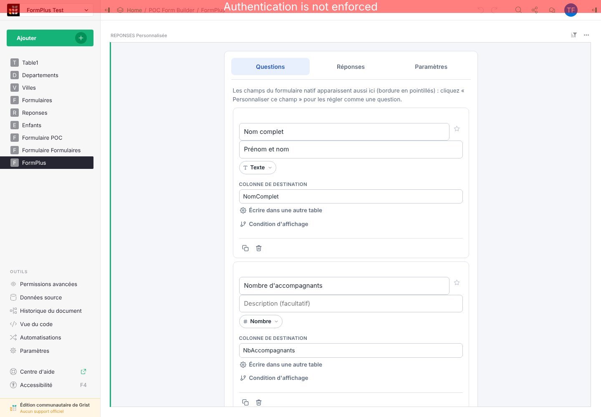
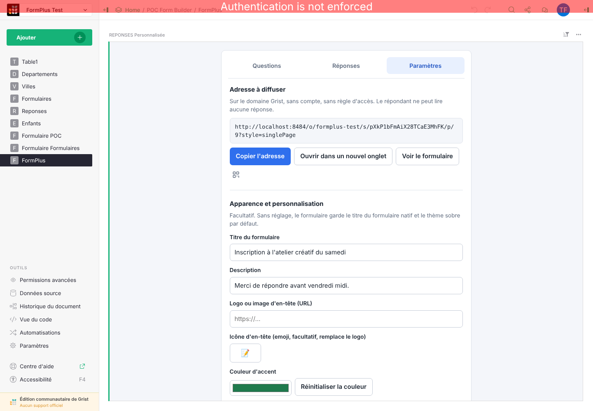
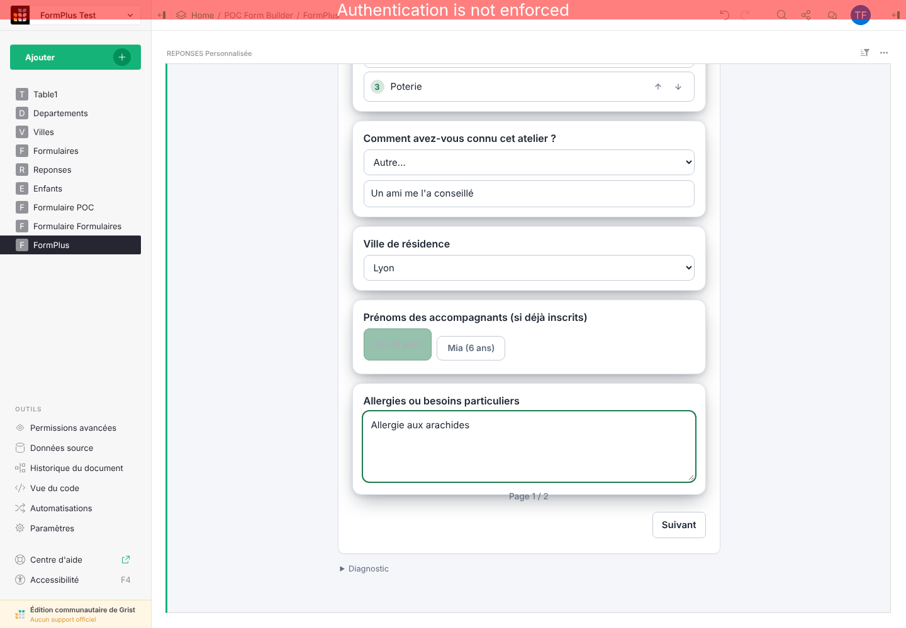
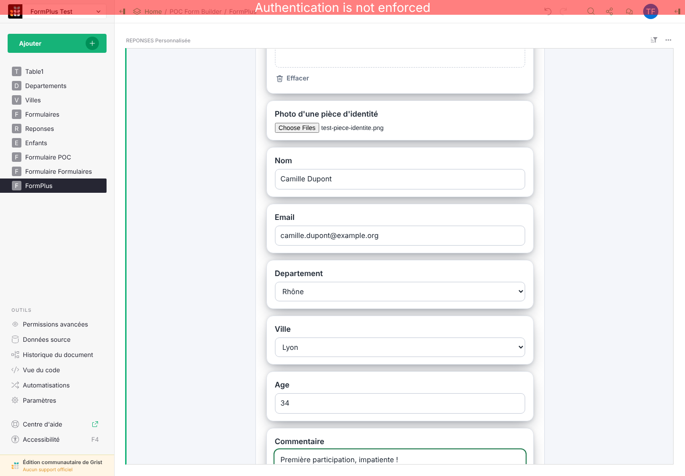
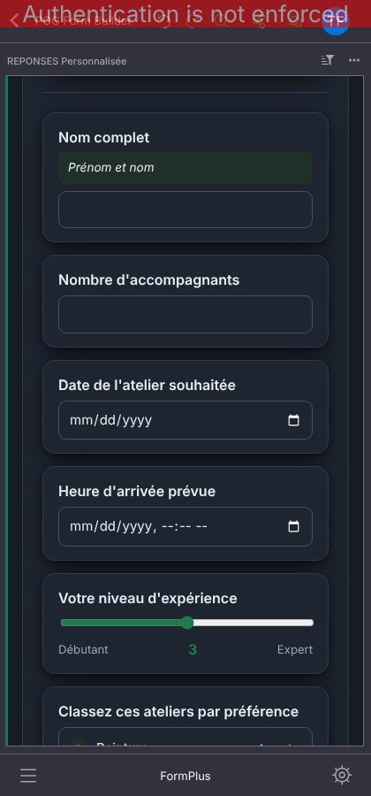
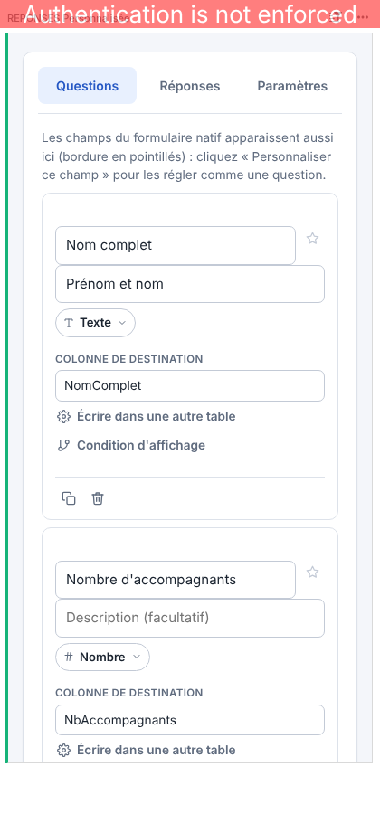

# Tutoriel : construire et diffuser un vrai formulaire

Ce tutoriel suit un cas d'usage réel de bout en bout — « Inscription à un atelier créatif du
samedi » — construit et testé le 21 octobre 2026 sur un Grist auto-hébergé (`tests/grist-env/`),
avec un vrai document, de vraies tables et un vrai envoi. Il complète `docs/04-architecture.md`
(comment le code est organisé) et le rapport d'audit UI/UX (lien dans `docs/03-roadmap-priorites.md`)
en montrant le widget en usage, captures à l'appui.

## Le scénario

Un centre de loisirs ouvre les inscriptions à un atelier créatif du samedi. Le formulaire doit
recueillir : nom, nombre d'accompagnants, date et heure d'arrivée souhaitées, niveau d'expérience
(échelle), ateliers préférés (classement), comment la personne a connu l'atelier (choix fixe avec
« Autre »), ville de résidence (choix depuis la table `Villes`), prénoms des enfants accompagnants
(liste de références depuis `Enfants`), allergies (texte libre), une page 2 conditionnelle
(affichée seulement si la personne vient accompagnée) avec signature de décharge et photo d'une
pièce d'identité, puis les champs natifs Grist Nom/Email/Département/Ville/Age/Commentaire déjà
présents sur le formulaire publié d'origine.

Ce scénario couvre volontairement la quasi-totalité des types de question de FormPlus et les deux
façons d'écrire les réponses (colonne de la table principale, colonne d'une autre table).

## 1. Partir d'un formulaire natif Grist déjà publié

FormPlus vient compléter un formulaire natif Grist existant, jamais le remplacer. Avant toute
chose, publier un formulaire natif classique dans Grist (bouton « Publier » du formulaire) et
copier son lien (`Copier le lien`) : c'est ce lien qu'on colle dans FormPlus à la première
ouverture.

## 2. Ajouter les questions dans l'éditeur FormPlus

Une fois le widget FormPlus ajouté sur une page du document et le lien du formulaire natif collé,
l'onglet **Questions** liste d'abord les champs du formulaire natif lui-même (bordure en
pointillés), puis permet d'ajouter des questions FormPlus en plus. Chaque question choisit son
type (Texte, Nombre, Date, Échelle, Classement, Choix depuis une table, Liste de références,
Pièce jointe, Signature, Nouvelle page...), sa colonne de destination dans Grist (créée
automatiquement si elle n'existe pas encore) et, en option, une condition d'affichage qui dépend
de la réponse à une autre question.

Pour ce scénario, la colonne de destination de chaque question a été laissée vide puis tapée à la
main (ex. `NomComplet`, `DateAtelier`, `SignatureDecharge`) : FormPlus a créé lui-même les 10
colonnes Grist correspondantes, avec le bon type (Texte, Nombre, Date, Date-heure...), sans
manipulation côté Grist.

## 3. Récupérer l'adresse à diffuser

L'onglet **Paramètres** affiche l'adresse à copier ou le QR code à scanner, et permet de
personnaliser le titre, la description, le logo, la couleur d'accent et le message de fin du
formulaire.

**Point d'attention vérifié ce jour (21 oct) : cette adresse, copiée telle quelle et ouverte par un
visiteur neuf, affiche actuellement l'écran de configuration ci-dessus plutôt que le formulaire à
remplir** — voir le constat détaillé plus bas. En attendant une correction, seul le bouton
« Voir le formulaire » (dans la même session que l'éditeur) donne un aperçu fonctionnel du
formulaire répondant, comme montré ci-dessous.

## 4. Ce que voit le répondant

Vue bureau, thème clair, page 1 (texte, nombre, date, date-heure, échelle, classement, choix avec
« Autre », choix depuis une table, liste de références, texte libre) :

Page 2 (affichée seulement parce que « Nombre d'accompagnants » ≥ 2), avec signature dessinée,
pièce jointe et les champs natifs importés :

Vue mobile, thème sombre (respecte automatiquement le thème du système d'exploitation du
répondant) :

## 5. Deux points de vigilance avant de diffuser un vrai formulaire

Ce test réel a aussi mis en évidence deux limites actuelles, documentées en détail dans le rapport
d'audit UI/UX (lien depuis `docs/03-roadmap-priorites.md`) :

- **L'adresse à diffuser n'ouvre pas encore le formulaire pour un visiteur neuf** — elle ouvre
  l'écran de configuration (capture ci-dessous, prise en ouvrant cette adresse dans un navigateur
  sans aucune session). À ne pas diffuser tel quel pour l'instant.

  

- **Une condition d'affichage posée sur une question « Nouvelle page »** (comme la page 2 de ce
  scénario) bloque le répondant si elle n'est pas retirée au préalable : préférer, pour l'instant,
  un saut de page sans condition, ou une condition posée sur une question normale plutôt que sur
  la page elle-même.

- **Une pièce jointe ou une signature qui échoue à l'envoi** (erreur Grist déjà connue, cookie
  cross-origin) peut faire perdre toute la réponse si son type écrit dans la table principale —
  éviter de rendre ces champs obligatoires tant que ce point n'est pas traité.

## Pour aller plus loin

- `docs/04-architecture.md` : organisation du code, modules, suite de tests.
- `tests/README.md` : relancer ce même environnement Grist auto-hébergé en local.
- `docs/06-carte-interactive.md` : activer la question « Lieu sur carte » (désactivée par défaut).
